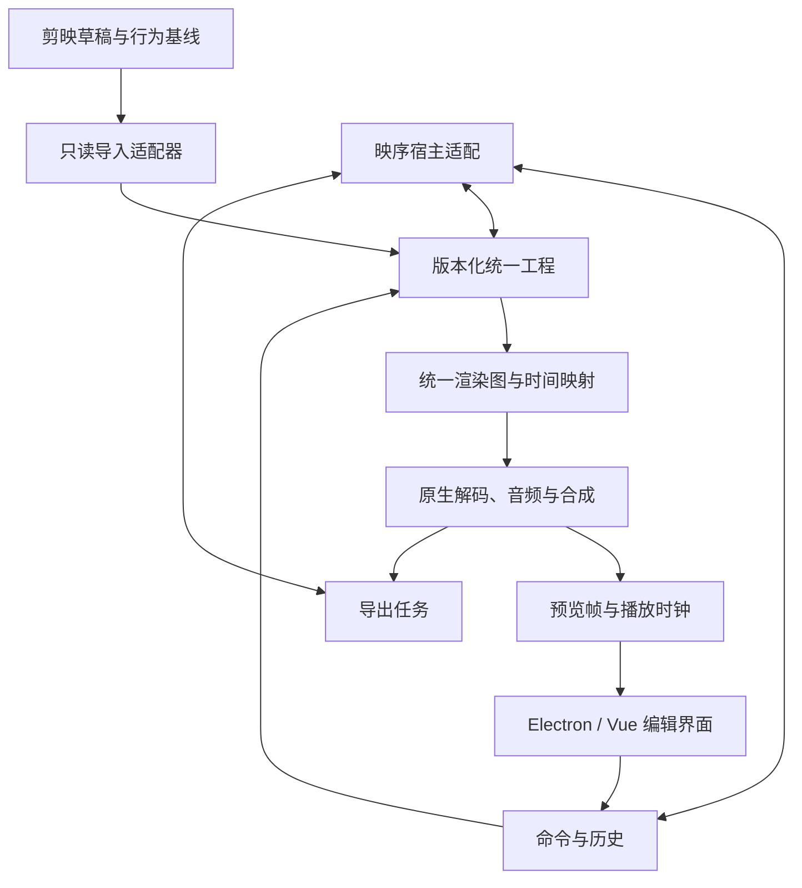

# 剪映5.9.0复刻与映序接入设计

确认日期：2026-10-19。用户确认原文：「确认，按推荐架构推进」，随后明确「团队更熟悉vue」「UI组件可以用Ant Design Vue」。按后续偏好将编辑器界面改为Vue 3＋TypeScript＋Ant Design Vue，独立内核、媒体引擎与映序接入边界保持。对照程序为 `/Applications/VideoFusion-macOS.app`，版本5.9.0，bundle ID为 `com.lemon.lvpro`。

## 目标与完成定义

复刻范围覆盖固定版本的可观察界面、操作、工程语义、预览与导出行为。成功后把独立编辑器内置映序，共用素材、生产成果和工程入口。完整目标不因分阶段实施而缩成简易时间线。

「1:1」按四层分别验收：

1. 界面：同窗口尺寸、显示缩放、语言、快捷键配置及操作状态下，对照布局、内容、焦点和交互反馈。
2. 编辑行为：同素材、同操作序列下，对照轨道、源区间、目标区间、关键帧、撤销和保存重开结果。
3. 媒体结果：对照逐帧画面、时间映射、字幕、声音和实际导出参数；不把不同编码容器的字节差异直接判作功能失败。
4. 运行行为：对照播放、定位、缓存、导出、长工程及错误恢复。性能阈值在同一设备取得基线后冻结。

目前只有局部反汇编与六秒素材实验，尚不能承诺整个版本已经可完全还原。符号存在、字段存在与真实操作通过分别记账。云端AI、在线素材、会员功能和离线编辑能力均登记；需账号或服务的项目保留未验证状态，不默认为可用或从范围中删除。

## 已有证据和现有映序约束

- 目标为Qt6.2与C++原生编辑模块；401个可见QML文件均为通用Qt组件，未取得核心界面源码。
- `splitVideo`已定位到命令分派入口，未恢复底层分割算法。
- 六秒、30fps素材在三秒处分割为两个三秒片段；第二段二倍速后源区间仍三秒，目标区间1.5秒，总长4.5秒；撤销恢复原tracks和materials。
- 缩放关键帧原始偏移为3000000与5000000。本例源时钟与全局时钟重合，不能据此确定坐标系。
- 实际导出MOV为1280×720、30fps、180帧、六秒，另有MP3和GIF。
- 现有映序为Electron/React、Express/SQLite；`timeline.mjs`固定24fps与720p，单画面轨；预览靠FFmpeg完整渲染；编辑历史保留30个快照。
- `.yg`现有工程包、交付、素材和生产任务须保留。初始开发位于本独立仓库。

原始证据入口为 `../剪映5.9.0复刻分析_20261018/`（相对仓库根）；本仓库的 `docs/parity/baseline.json` 记录文件哈希。

## 架构选择

采用Electron桌面宿主、Vue 3＋TypeScript＋Ant Design Vue编辑界面、独立工程与命令系统、独立原生媒体引擎，以及映序宿主适配。

另外两条路线已比较：Qt原生界面能接近目标技术栈，但嵌入Electron增加边界和维护成本；直接扩展映序旧时间线能复用入口，却受单画面轨与固定帧率约束。用户已选择独立编辑器路线。

框架取舍以团队维护能力为先。React能复用映序既有组件，但团队更熟悉Vue，因此编辑器采用Vue。Vue官方支持Electron和跨框架Web Components；性能仍须测量，大列表虚拟化和减少深层响应追踪均需主动设计，不能宣称换框架即能解决剪辑性能。参考：[使用方式](https://vuejs.org/guide/extras/ways-of-using-vue.html)、[性能](https://vuejs.org/guide/best-practices/performance.html)（2026-10-19核对）。

### 统一工程

核心包独立于Vue、React、Electron、数据库和FFmpeg，可由CLI回放。内部工程使用自己的 `schemaVersion`，剪映的 `version/new_version` 只作为来源元数据，不用来推断应用版本。

工程包含画布、帧率、素材、轨道、片段、效果与关键帧。素材是媒体身份，片段是一次采用，同一素材可出现在多个片段；来源素材ID与内部ID可映射，不要求内部ID复刻目标随机UUID。

时间采用规范化有理数 `{numerator: string, denominator: string}`；分母为正，约分存储。通过BigInt计算，以字符串写JSON，禁止浮点累计。帧率同样使用有理数，支持30000/1001这类值。源区间与目标区间独立，区间为左闭右开；帧显示仅在边界显式量化。原始微秒值应无损转换，不因UI帧格吸附而改写。

首包只规范化已证明的恒定速度与区间字段。未确认的效果、变速曲线和关键帧放入原始来源副本并产生诊断。后续确认其坐标系后再做版本化迁移，保留迁移前副本。

### 命令与历史

所有修改通过命令提交，绑定基线修订号。命令成功后一次性产生新工程修订和结果摘要；失败时工程与历史都不变。撤销/重做恢复内容，修订号仍递增，防止迟到请求覆盖新状态。

首包提供分割、恒速、撤销、重做。分割保留左段ID，右段使用调用方预先分配的唯一ID，确保日志可重放。内部引用可共享素材，不模仿剪映因分割生成的冗余素材表；跨实现对照使用语义投影。

恒速仅改变目标时长，源区间保持，是否移动后续片段由显式参数决定。六秒样例没有证明后续片段的涟漪规则，不能用这个样例给默认联动行为下结论。

拖动、属性连续编辑、组合操作的撤销粒度需进一步实测。自动保存采用原子落盘、修订号和恢复日志；明确持久化成功与否，恢复不自动重复导出任务。

### 原生媒体引擎

引擎在独立进程中运行，第一目标平台macOS arm64；x86_64后续独立验收。界面通过版本化协议提交工程与作业，不直接调用剪映私有动态库。

工作分解为探测、素材时间映射、解码、图像/音频效果、合成、播放时钟、导出。原生具体语言、GPU帧传递与音频设备方案在媒体包的性能探针中选择，当前不把尚未测量的实现选择写成结论。可先以FFmpeg建立CPU导出参照，再评估VideoToolbox/Metal的实时链路。

`RenderGraph`在同一修订中冻结输入、操作顺序、时间映射、画布、色彩和字体引用。预览与导出消费同一语义；允许预览降低分辨率，但不得改变剪辑时间、效果顺序或文字布局。FFmpeg与硬件编解码版本写入作业记录。

所有任务都有jobId、documentRevision、documentHash、输入哈希和状态。取消只作用于对应子进程，输出先写临时文件，验证成功后再提交结果；崩溃后查询或恢复原作业，不以新提交掩盖未知状态。

### 编辑界面

界面采用Vue 3单文件组件、Composition API与TypeScript。常规按钮、下拉菜单、弹窗、表单、提示和设置使用Ant Design Vue；字体、色彩、间距、焦点与密度按剪映对照定制，不直接沿用默认管理后台视觉。时间线、预览画布、波形、关键帧与曲线编辑器由专用组件实现。库版本在首次安装时核对官方发布与Vue兼容性并锁定。官方入口：[Ant Design Vue](https://www.antdv.com/index-cn)（2026-10-19访问；站点由客户端渲染，静态抓取未返回正文）。

工程不可变快照通过浅响应引用接入界面，选择/焦点/播放头等视图状态单独保存。时间线只绘制可见范围，不为每一视频帧创建DOM；实际Canvas/GPU绘制路线通过性能用例决定。

按剪映5.9.0逐屏记录窗口、素材区、预览区、属性区、轨道、菜单、快捷键、导出、错误态和保存重开。先以完整操作用例驱动界面，再逐屏对齐尺寸、颜色、图标、文字和状态。

研究记录和进度不进入产品主界面。媒体缺失、未知效果等提示使用实际影响说明。快捷键需区分本机已选Final Cut Pro X配置与出厂配置，不能把当前配置写成默认。

### 映序宿主适配

编辑器公开 `mountEditor(container, options): EditorHandle`，handle提供 `open(document)` 与 `dispose()`；宿主通过明确的事件和异步接口提供素材、保存及导出。React只拥有容器节点，Vue拥有容器内部子树；卸载时调用dispose清理应用、监听器、播放时钟与对象URL。双方不直接共享React hooks、Vue响应代理或组件内部状态。样式限制在编辑器根容器内。

接口职责为解析素材版本、打开/保存编辑工程、提交作业、展示成果、写入来源关联。生产节点ID/版本、素材哈希与编辑修订保持关联；上游变化不能静默改写已冻结编辑工程。

新编辑文档先用独立字段与独立入口，读旧工程时进行显式转换。转换是复制，不原地改写旧时间线；未知内容列出差异。`.yg`包加入版本化可选编辑清单时，旧包仍可导入，恢复后必须检查媒体URL、HTTP206和工程重开。

独立验证通过后再提交映序接入实现，届时以生产平台自己的AGENTS.md、运行时与检查流程为准。

## 数据、失败与兼容约束

- 未知字段原样保留至独立的来源副本，内核不遍历执行其中的路径、脚本或网络地址。
- 导入不读取或修改目标应用草稿；CLI指定某个快照文件，不扫描全部用户草稿。
- 解析拒绝非有限数字、无效分母、重复ID、悬空素材、负时长和不支持的核心结构；拒绝时不返回半个可编辑工程。
- 不能解释的视觉/音频效果必须产生诊断；对结果有影响但未支持时阻止无提示的成片发布。
- 媒体解析、预览、导出与宿主错误使用稳定错误码，并保留具体对象ID和可恢复状态。
- 内容哈希只覆盖规范化工程；界面选择、播放头、缓存和作业进度不计入内容哈希。原始来源也独立哈希。

## 验证策略与验收纪律

工程内核优先验证精确时间与状态恢复；真实草稿用于集成回归。原生媒体使用实导出作为参照，分开比较容器、解码帧、声音、字体和颜色。UI必须实际操作，不能用组件测试替代完整编辑路径。

首批原生对照实验：片段移动后关键帧、带源入点裁切后关键帧、恒速后关键帧、第三段受前段变速影响、叠轨顺序和透明度、保存退出再打开、取消导出。每个实验只改变一个因素，记录前后草稿、操作顺序和真实导出。

所有对照条目分别记录目标证据、实现证据、差异和验收日期；未测试与失败分开。没有可靠性能基线时记录实测耗时，不虚构实时指标。全量目标是否完成由登记册和全部复查决定，不按已做百分比推断。

## 实施包

1. 工程与命令：精确时间、只读草稿导入、源/目标区间、恒速、分割、历史与可重放回归。
2. 媒体引擎：探测、统一渲染图、导出参照、播放时钟、缓存与原生合成。
3. 编辑界面：完整操作路径、属性和素材面板、快捷键、各状态逐屏对照。
4. 映序宿主：素材/版本、生产节点、.yg迁移、作业与成果接入。

四包保留独立验收边界。首包的逐步实施计划已单列；后续包在对应前置实验完成后细化实现步骤。完整路线与所有已知缺口见 `2026-10-19-delivery-roadmap.md` 和功能登记册。
