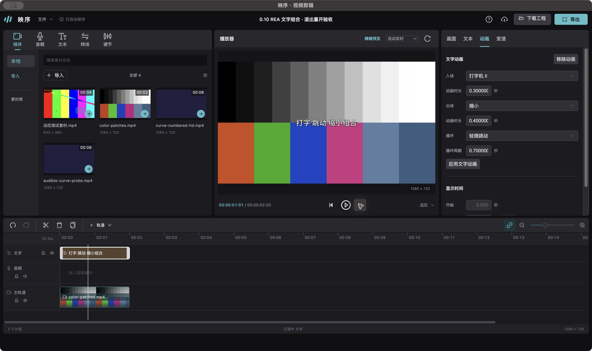

# 0.10 预设、复杂组合、转场重建与首次准备

固定本机剪映专业版5.9.0，继续实际使用REA、正常原生UI、真实MOV和独立实现。本轮交付0.10.0开发包；**完整1:1尚未完成**，全部目录和多元素模板不能由本轮结果推断通过。生产映序、剧集、旧基线未改。

## 新增实现

- 入场「打字机 II」逐字quartic透明度、出场「缩小」二次透明度与缩放、循环「轻微跳动」六段整行位移。10个原生MOV覆盖混合换行、两种非整周期三阶段组合、横/竖/方屏及缩放旋转；修复出场保留最后loop输出帧位置，源变换与预设缩放分别计算。当前已验证九项文字资源，字体及抗锯齿仍有差异。
- 精确文字采用黑白双观测逐帧流式恢复并编码PNG，去掉整窗口raw中间文件，保留背压、双子进程回收、取消和预算。180帧优化前后逐帧PNG SHA完全相同；相同CLI实验冷准备19.039→4.763秒。单批32帧/128MiB、GPU32张/128MiB、服务512张/256MiB保持。
- 受限yuv444p输入的擦除/圆形GPU转场新增半分辨率UV表面与中心双线性重建。60帧全幅真实GPU对原生最大差110→35、150→39；对独立数学最大差<.5码值。新增FBO为921,600字节，三FBO总8,294,400字节。CPU候选极值变差，未采用，原67/109残差继续保留。

## 实际性能与像素

最终源码冻结、338项回归与构建完成后，由父任务Cua点击真实页面。Apple M3硬件WebGL2，1280×720/30fps、有声视频和180个连续唯一文字帧。性能期间本任务其他重计算停止，边界ps记录外部FFmpeg为0；边界记录不是全程系统监控。

| 模式 | 准备 | 播放调用墙钟 | 输出/解码掉帧 | 等待 |
|---|---:|---:|---:|---:|
| 单帧冷控制 | 8.525秒 | 36.429秒 | 0/135 | 145 |
| 流式批量冷 | 6.941秒 | 6.178秒 | 0/0 | 0 |
| 保留服务缓存三连播 | .346/.278/.285秒 | 6.174/6.162/6.166秒 | 全部0/0 | 全部0 |

批量冷transport anchor后为6.022秒；6.941秒包含首帧/首窗和显式磁盘准备，不能只报其中4.332秒服务耗时。上一版真实冷准备15.373秒，本轮约减少55%，为两版本独立轮次；严格同输入CLI前后结果另列。四次batch的rAF最大9.3—9.4ms；仍保留0.9的633ms异常及本轮不实时的scalar控制。探针改为紧凑可见DOM，完整raw照常落盘；这是harness变化，不能据此断言旧异常原因或算作产品修复。未作听审。

63帧GPU文字像素检查：旧22帧最大差2，新41帧中打字机II六汉字第6帧最大差3，其余最大2，alpha差0。文字context自动恢复及同帧seek确认均逐字节一致。新转场另做真实三FBO丢失恢复：自动ready回调先读取原61帧，完整RGBA差0；旧句柄失效、新三个句柄有效，seek62、暂停与释放后0残留、GL错误0。

转场新GPU平均1.620/1.720ms，较显式v1控制增加约.21/.22ms；CPU warm p95≤2.7ms。首次wipe draw含编译分配313.9ms，尚未消除，完整保留。该60帧脚本包含seek/readback及独立参考计算，不能当连续播放FPS。

## 桌面与自动验证

- Node24全量338/338、九项真实草稿基线、Vue类型检查和桌面构建通过。日志与结果在`evidence/2026-10-19-integration-v10/`。
- 运行时提交`6f073257e42f9bce495c2598f48be52b8c9ed7b0`，0.10.0实际应用`artifacts/desktop/20261019223703/映序剪辑.app`。本地ad-hoc签名严格验证通过，仍依赖本机FFmpeg/FFprobe/Rubber Band，未宣称公证分发。
- 后端bundle SHA256为`9dd0e48d248842e26ab8a41f2a17e31bee8656f3f31cbbe9fd7b20e56b83c204`；前端入口`editor-BUjq-0Sy.js`为`f954cc64aae268e5646c42b801f5bb178479fbeae89fed536b32db95ff94284b`。真实HTTP资源与包内内容比对记录在`packaged-integrity.json`，开发探针与打包引擎身份分别保存。
- 实际UI设置打字机II .3秒/缩小.4秒/轻微跳动.7秒，持久修订1一致；查看9/30/31/48/51帧。撤销修订2去掉动画，重做修订3恢复；真实UI导出完成，H.264/AAC、1280×720、30fps、60帧、2秒，完整解码通过，HTTP206/1024字节，实际31帧另作目视复核。
- 中文标题输入保持焦点时CmdQ正常退出，进程消失；实际重开新进程后修订4保留标题、三动画和导出任务。20次挂载卸载的DOM/迟到更新/卸载后请求为0；打包预览context恢复同像素、不自动播放。

## 复杂模板的新增证据与剩余工作

正常UI取得免费「雨过是天晴」模板，真实导出90帧；除初始透明第0帧外89帧均可见，关键帧联系表已实际查看。它含三段文字和独立贴纸、四套动画、逐字渐变填色/渐变柔影、两套字体和布局锚点。贴纸动画只存在于模板content资源树，不能仅读draft动画引用。实际1,799,999μs与资源1.8秒差异也保留。

该模板目前是有效研究样本，**产品尚未实现**。已写明受限group IR、子层非等比仿射、锚点依赖排序、富字形渐变/柔影、多pass动画及重定时的具体取证矩阵，见文字报告。没有用普通三阶段组合代替模板，也未执行私有脚本或把私有字体/素材复制进产品。

完整预设/特效/转场商店、其余复杂模板和字形、所有参数/画幅/HDR/VFR及几何组合、长工程和多路GPU性能、首次shader编译阻塞、原生字体与剩余像素误差、逐屏UI、云端能力、映序宿主接入均未完成。全部1:1验收仍未通过。

## 取证与清理

REA文字14次、转场10次新调用，区分静态库存、人工资源核对与真实运行证据。文字附snapshot close的integrity_mismatch失败保留，补充会话无snapshot正常close；两条调查均export/close/STOP并退出。REA观察的Metal/色度名称和模板接口不冒称恢复了媒体算法。

原生专用草稿正常退出后恢复47395原字节，SHA256 `fbdb4f89720816fbffcb9cc42cc3236d3ef641da771ff78da0d348abc8a48a82`。模板分类网络错误和一次正常重试保留，之后简约分类成功，不能将先前错误当全目录不可用。

期间原生导出触发至少5GB空间检查。只对本任务旧QA的100个raw RGBA做无损gzip，逐一还原核SHA后归档原字节，节省1,278,027,124字节；未删生产媒体、旧原生MOV或app。完整归档清单保留。正常退出重开原生后导出成功，未绕过保护。

8838/8839/8841与自有观察器均已停止，临时浏览器测试标签已关闭。0.10桌面应用保留打开。分项记录：

- [文字、组合与真实模板](2026-10-19-text-presets-v10.md)
- [首次准备与全部真实GPU轮次](2026-10-19-gpu-preparation-v10.md)
- [转场完整采样、计时与context](2026-10-19-transition-edges-v10.md)
