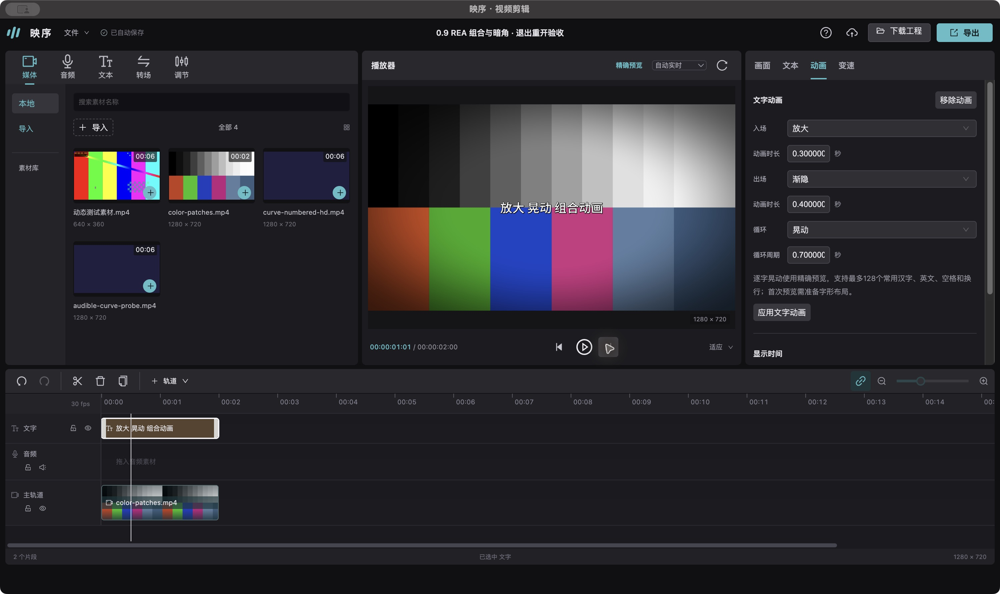

# 0.9 预设、复杂组合、转场边缘与GPU预览

本轮固定本机剪映专业版5.9.0，继续使用REA定向分析、真实草稿、正常原生导出与独立实现。完整1:1尚未完成；本轮验证不能替代完整资源目录、所有组合和宿主接入验收。

## 已实现

- 新增入场“放大”和逐字循环“晃动”，支持与渐隐组合。原生四条循环/组合输出中，去除入口阶段后447帧的相位状态一致；特别保留入场后半周期与整周期的左侧端点。字形布局、透明度和渲染误差分开记录，不能据相位一致宣称字体像素一致。
- 新增版本化暗角，正值压暗、负值提亮；CPU使用16位有界遮罩，GPU按源UV计算，预览、导出、导入、编辑及历史共用参数。四个强度原生全幅MAE分别0.592499、0.912810、0.745542、0.788894，最大误差仍为60—71。
- 修正已验证条件下擦除和圆形转场的平面边缘。CPU对原生最大误差从150/239降为67/109，非边缘均值略有退步，证据完整保留。GPU独立公式误差低于0.5码值；浏览器MOV路径对原生仍有110/150最大差异。资格限于已验证不透明、无方向变换、CFR30、1280×720和1倍速等条件。
- GPU文字增加有界滚动窗口、串行批量栅格和显式准备。GPU解码预算保持32张/128MiB；服务永久PNG预算512张/256MiB，另计JSON及批量临时raw。新修订、取消和旧窗口不再发布迟到结果；同一输出帧不反复prepare，解决素材先结束导致末帧反复等待的问题。

## 自动验证

最终Node24全量314/314项通过，0失败；九项既有真实草稿对照、Vue类型检查和桌面构建通过。最终日志位于`artifacts/qa/integration-v9/final-tests.log`、`final-build.log`及`baselines.log`。测试包含真实FFmpeg/HTTP、取消/修订竞争、alpha、方向探测、字形动画和输出时钟，并非只有数学模拟。

## GPU实际播放

1280×720、30fps、有声音视频与180个连续唯一文字帧，Apple M3硬件WebGL2，GPU缓存峰值32张/117,964,800字节。最终源码冻结并完成全量检查后实测：

| 模式 | 准备 | 播放调用墙钟 | 输出/解码掉帧 | 等待事件 |
|---|---:|---:|---:|---:|
| 单帧冷基线 | 9.116秒 | 44.227秒 | 0/127 | 145 |
| 批量PNG冷 | 15.373秒 | 6.172秒 | 0/0 | 0 |
| 首次缓存三连播 | .431/.354/.598秒 | 6.167/6.180/6.298秒 | 0/0、0/0、18/44 | 0/0/1 |
| 独立追加三连播 | .378/.285/.297秒 | 6.187/6.189/6.168秒 | 均0/0 | 均0 |

批量冷样本的transport anchor后为6.018秒，前置准备成本必须共同计算。异常轮有633.3ms rAF间隙，仍前台且有焦点，无LongTask记录；同轮曾中途读取大型AX树，但不能据相关性证明原因。追加轮不读AX，三次通过；全部七次batch及早期V1/V2慢样本保留，不能只报最好结果。22个GPU文字/新预设/组合像素检查最大差2码值；上下文自动恢复与同帧确认读取均完整RGBA零差。未作听审。

## 实际桌面包

- 运行时提交：`effc1f39893b06b2d87120e414932e9a06ac0419`。
- 独立0.9.0应用：`artifacts/desktop/20261019214700/映序剪辑.app`，已实际打开；Electron44.6.0，本地ad-hoc签名，`codesign --verify --deep --strict`通过。仍需本机FFmpeg/FFprobe/Rubber Band，不是公证安装包。
- 打包与实际后端SHA256一致：`ed29999555b3825fd0806c311add12fcc243486b09a1a0e11b7ecedc0d2926c2`。实际前端`editor-Pu9ocGn4.js` SHA256：`b9bc98d14e0d70358edff7a5f4119f37162573649168ced17a3f6ab1fc7e1b44`。
- 独立色卡工程实际UI设置暗角25（强度.5）、放大.3秒/晃动.7秒/渐隐.4秒；服务持久记录与UI一致。撤销修订3移除组合、重做修订4恢复；逐帧检查9/30/31/48/51并实际播放到2秒。
- 正常UI导出任务完成：H.264/AAC、1280×720、30fps、60帧、2秒，完整解码通过，HTTP Range返回206及1024字节。实际导出第31帧另作画面复核。
- 完整中文标题在输入框保持焦点时CmdQ退出，正常关闭后重开新进程，修订6保留标题、暗角、三动画与1个导出任务。最初原生`typeText`漏中文的试验记录保留，改用剪贴板粘贴后才通过完整标题验收。
- 打包版本20次挂载/卸载：DOM残留0、迟到更新0、卸载后请求0、20次disposed-open拒绝；实际GPU context丢失后恢复ready、相同像素、不自动播放。

首次重载曾显示空白，彼时另一个自有0.8包也在运行，Console无错误；两个包正常退出后单独重开0.9成功。没有据此断言原因，也未将并发多实例列为通过。完整桌面原始材料保留`artifacts/qa/desktop-v9/`；可入库的检查、构建、HTTP、生命周期、恢复及截图在`evidence/2026-10-19-integration-v9/`。

## 分项证据

- [文字预设与原生组合](2026-10-19-text-presets-v9.md)
- [暗角与四强度原生/GPU对照](2026-10-19-vignette-v9.md)
- [空间转场边缘与方向资格](2026-10-19-rea-transition-edges-v9.md)
- [GPU缓存、冷准备及完整播放](2026-10-19-gpu-rolling-v9.md)

本轮REA包括新的文字桥接/资源查询、NV12定向调用及效果资源核对；目录目标打开失败也保留，不能把包装函数或资源字符串冒充完整算法。私有资源代码只留在ignored分析目录，产品实现使用独立数学与媒体链。

## 尚未完成的对照

已核验文字预设为渐显、渐隐、打字机I、闪烁、放大、晃动六项资源。“放大缩小”候选在正常原生导出时要求登录，未取得MOV，未绕过登录或作为已支持预设。全部预设/特效/转场、未知caption/group模板、复杂字形与小字号、所有参数组合、原生字体抗锯齿、任意色域/HDR/VFR/几何转场、全媒体实时GPU路径、云端能力、逐屏UI和映序宿主接入仍有缺口。锐化只有资源线索，未宣称实现。

原生专用实验草稿已正常退出后恢复原47395字节，SHA256为`fbdb4f89720816fbffcb9cc42cc3236d3ef641da771ff78da0d348abc8a48a82`；没有修改生产映序或剧集资料。

本轮自有REA均export/close/STOP完成，GPU分析服务与观察器已停止，8838/8839/8841无监听；临时浏览器测试标签关闭，最终0.9桌面应用保留供查看。
