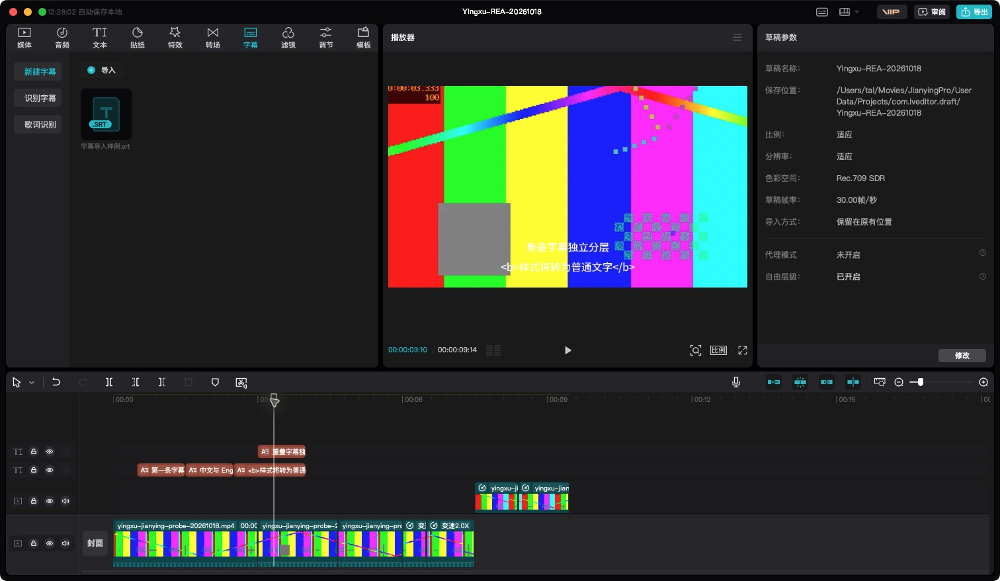
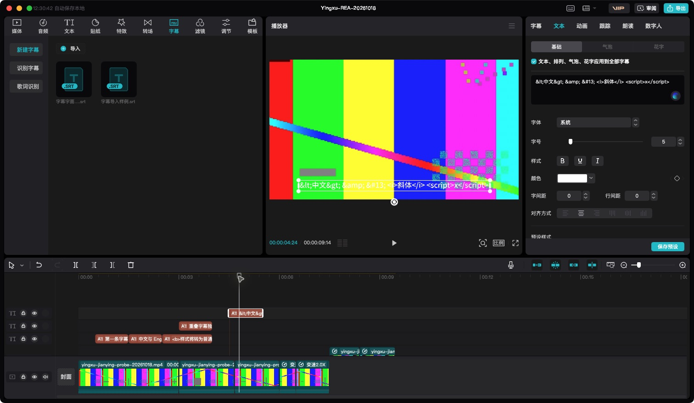

# 剪映5.9.0本地SRT实测

日期：2026-10-19。全部原生界面操作通过CUA，目标只使用专用工程 `Yingxu-REA-20261018`。此前曲线变速及分割后的两个视频轨保持逐字段相同；未修改目标程序、历史快照或其他工程。

## 路径与输入

“字幕→新建字幕→导入文件”支持入口提示为SRT、LRC、ASS。选择SRT后先进入字幕素材库，此时草稿尚未新增文本轨。播放头回零后点击素材缩略图右下添加控件，才把全部字幕加入时间线。双击只进入素材预览；本次拖入尝试没有改变草稿，未将未生效操作当成功。

原输入四条：

| 内容 | 开始/结束（秒） | 目标结果 |
| --- | --- | --- |
| 第一条字幕 | 0.5 / 1.5 | 第一文本轨 |
| 中文与 English＋换行＋两行保持换行 | 1.5 / 2.5 | 第一文本轨，保留换行 |
| `<b>样式将转为普通文字</b>` | 2.5 / 4.0 | 第一文本轨，标签字面保留 |
| 重叠字幕独立分层 | 3.0 / 4.0 | 第二文本轨，自动上移 |

微秒开始/时长分别为500000/1000000、1500000/1000000、2500000/1500000、3000000/1000000；各段 `source_timerange=null`、`speed=1`。第一文本轨有3段，第二文本轨有1段，两个轨的 `flag=1`。

## 字面语义

实际3.3秒导出画面清楚显示 `<b>` 与 `</b>`，不是加粗标记。追加独立样例：4.5—5.5秒的 `&lt;中文&gt; &amp; &#13; <i>斜体</i> `。在零点添加后，草稿 `content.text` 与输入逐字相同；4.8秒播放器实际显示entities和全部标签字面，没有实体解码、斜体应用或标签剥离。追加样例仅检验播放器，没有重新导出整片，原MOV不包含这个追加cue。

## 实际默认字段

目标画布为1920×1080、30fps、Rec.709 SDR。未修改字幕样式。

| 字段 | 实测值 |
| --- | --- |
| UI字体、字号 | 系统、5 |
| `font_size` / `content.styles[0].size` / `text_size` | 5 / 5 / 30 |
| `font_name` / `font_title` | 空 / none |
| `font_path` 与富文本style的font.path | `/Applications/VideoFusion-macOS.app/Contents/Resources/Font/SystemFont/zh-hans.ttf` |
| font.id | 空 |
| `text_color` / `text_alpha` / `global_alpha` | #FFFFFF / 1 / 1 |
| `has_shadow` / `border_color` | false / 空 |
| `alignment` / `letter_spacing` / `line_spacing` | 1 / 0 / 0.02 |
| 片段alpha、rotation、scale.x/y | 1、0、1/1 |
| 第一层clip.transform | x=0、y=-0.8 |
| 重叠层clip.transform | x=0、y=-0.6000000000000001 |

空的 `material_animations` 引用为 `type=sticker_animation, animations=[]`；字幕原始文字存于materials.texts的JSON字符串 `content.text`，样式在 `content.styles`。

这些值是本样例默认值，不能把UI字号5或字段text_size30直接当成输出像素，也不证明所有文字的坐标规则已恢复。

## 原生导出及像素

只勾选视频导出，720P、推荐码率、H.264、MOV、30fps；单独音频和GIF导出未勾选。视频容器自带原音轨AAC。

原生输出 `artifacts/qa/subtitles-native/REA-subtitles-20261019.mov`：1280×720、284帧、9.466667秒，AAC 44100Hz双声道，完整解码通过。SHA-256：`c98a7cc22674ac54a0a87c5adc08a2b41de5989733c7e7b5a6b7b7144907c96d`。

实际查看了同目录 `at-0.7s.png`、`at-2.0s.png`、`at-3.3s.png`。首条字幕白色字形bbox为x552、y631、宽178、高35，中心(640.5,648)，与第一层中心落在0.9H相符。方法为原fixture第21帧放大参考，底部ROI内检测minRGB>200且最大通道差>80；这是阈值字形边界，不是字体身份或全排版一致性证明。

完整原始草稿、界面截图、追加样例与汇总见 `evidence/2026-10-19-subtitles/`。此子任务只收集对照证据，没有修改产品导入器、字幕默认值或界面；主任务依据证据修正实现。
