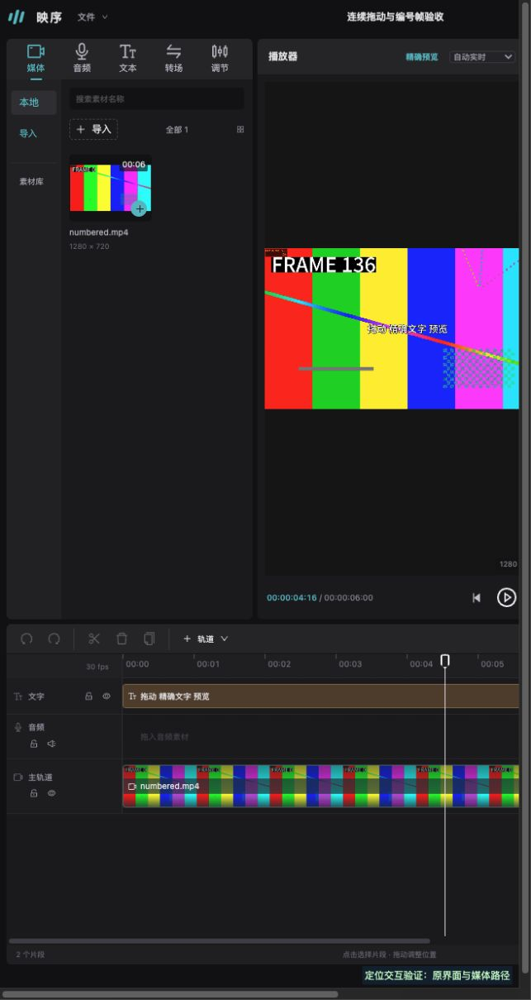

# 0.10.1 时间尺点击与连续拖动修复

用户截图指出时间尺点击卡顿、按住鼠标不能拖动预览。本轮只修复定位交互，未改文字数学、导出和媒体内容。

## 修复

- 时间尺及播放头手柄支持主指针capture/move/up，按rAF合并输入，播放头随鼠标更新；拖出时间尺仍捕获，松手立即刷新最后坐标。处理cancel/lostcapture、卸载及切工程，切换时废弃旧坐标。
- 预览定位串行执行一个任务，最多保留一个可替换的最新目标，持续拖动仍展示已经完成的帧；播放、工程、模式或卸载会清理旧队列。未使用松手后才更新的debounce。
- UI seek只准备准确目标帧，不为每次点击重新启动顺序文字预热；播放的显式准备/滚动窗口保持。等待提示延迟120ms，拖动等待时缩成角落提示，保留原画面，不反复用整幅模糊蒙层遮挡。
- 工程帧率、水平滚动坐标、片段拖裁切和缓存预算保持。冷文字帧仍可能需要生成，本修复不声称所有素材都能零延迟。

## 实际鼠标验证

独立数据目录、1280×720/30fps、6秒编号动态视频，加打字机II/轻微跳动/缩小的完整ASS文字。使用真实Cua鼠标输入操作实际Vue界面，不用脚本派发指针事件。测试页只增加只读MutationObserver/指针日志；最终页面reload后复测，JS bundle与最终.app内及HTTP提供的资源相同。

| 操作 | 按住时实际显示帧 | 松手后的准确帧 | 松手到准确帧 |
|---|---|---:|---:|
| 时间尺向前，149ms/8个move | 11/28/44/60/77 | 143 | 61.1ms |
| 时间尺向后，127ms/8个move | 143/127/95/64 | 17 | 42.6ms |
| 点击3秒 | 点击无持续拖动 | 90 | 37.5ms |
| 播放头向下拖出时间尺，148ms/8个move | 90/85/80/70 | 50 | 32.2ms |
| 最终构建向前，159ms/8个move | 11/27/42/58/74/89 | 136 | 61.9ms |

编号17、50、136的实际画面和播放头时码已核对；日志没有error/unhandled rejection。独立验收工程保持修订0、两个片段，定位没有产生编辑命令。数值是本次有限样本，不是所有工程性能保证；原始首次加载336.6ms也保留在trace，未把冷准备计入已缓存点击耗时。

## 回归与桌面包

新增队列合并/持续输出、错误恢复、reset/dispose迟到结果，以及真实GpuPreview目标帧不触发窗口预热回归。342项全量、9项基线、类型检查及构建通过。最后切工程/卸载坐标清理在最终源码再次typecheck、全量回归，并以最终构建实际拖动复测。

最终版本0.10.1，运行时提交`0c66063afebeeaf79299262357690a1c9b348f3c`，应用位于`artifacts/desktop/20261026181604/映序剪辑.app`。签名严格验证、后端SHA、三个真实HTTP JS bundle与包内SHA均核对。旧版正常保存退出，最终新包实际打开；窗口期间已有的修订12、四片段/八秒工程完整保留，保存重开前后document相同。没有回滚期间新增编辑。

最终包20次挂载卸载：DOM残留0、迟到更新0、卸载后请求0、disposed-open拒绝20次；GPU context恢复同像素且不自动播放。桌面AX确认新手柄及工程恢复。桌面窗口截图调用本轮一次超时，因此鼠标时序/画面证明来自相同最终前端的浏览器界面，不虚称本轮已录得原生窗口鼠标拖动截图。

证据位于`evidence/2026-10-26-timeline-scrub/`：全部trace/summary、最终界面、测试、构建、签名/HTTP、恢复与生命周期。临时8872/8873与测试标签已清理，最终App保留打开。独立数据及编号媒体在ignored artifacts，不进入用户工程。

